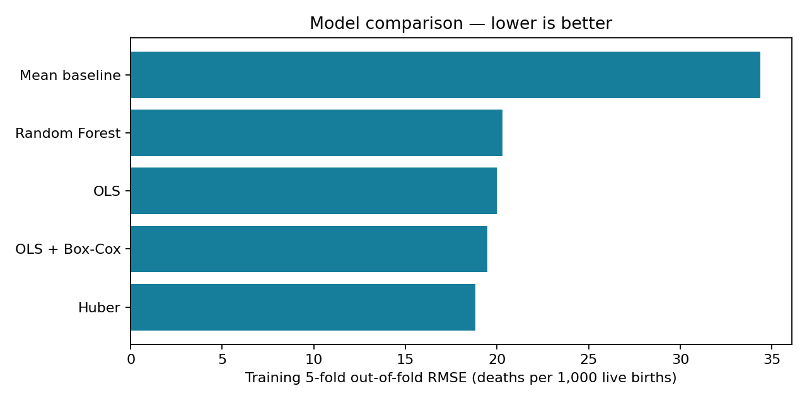
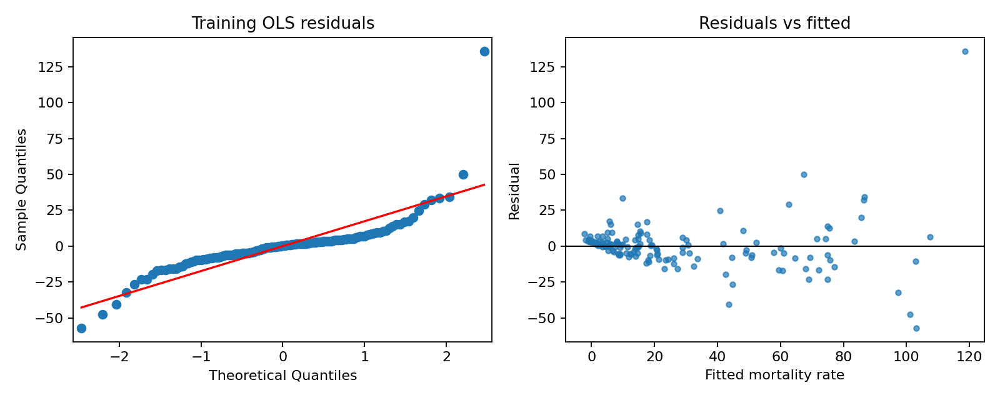

# Child Mortality Across Countries

An end-to-end statistical modeling project comparing OLS, Box–Cox regression,
Huber regression and Random Forest against a mean baseline using World Bank
2019 economy-level data. Outcome: under-five deaths per 1,000 live births.

**Research question:** How well do health-service coverage and economic indicators
predict cross-country variation in under-five mortality, and do flexible or
robust methods improve on OLS?

This is an ecological, retrospective analysis. It does not estimate individual
child risk or treatment effects. The repository contains CLI analysis and batch
prediction, rather than a clinical tool.

## Quick start

Python 3.11 or newer. In the project folder:

```bash
python -m venv .venv
# Windows PowerShell:
.venv\Scripts\Activate.ps1
# macOS/Linux: source .venv/bin/activate
python -m pip install -e '.[dev]'
python -m child_mortality --output outputs/local_run
```

The first run downloads World Bank API data; internet access is required.
To reproduce the included snapshot without downloading revised data:

```bash
python -m child_mortality --data data/raw/world_bank_2019.csv --output outputs/local_snapshot
python -m unittest discover -s tests -v
```

Use a new output folder for every run. See `outputs/reference/report.md` for the
executed reference analysis and `outputs/reference/summary.json` for exact
versions. `requirements-lock.txt` captures the tested direct dependency versions.
Cross-platform or library-version differences can change numerical results.

## Executed reference results

The saved snapshot has 217 eligible economies and 181 complete cases.
Training: 144; holdout: 36; Bangladesh: one separate case.
Huber achieved the lowest training CV RMSE (18.813). Its locked holdout
RMSE was 13.022, MAE 8.587 and R² 0.691. Bangladesh actual: 32.3;
predicted: 31.33 deaths per 1,000 live births. These results describe this
snapshot and split, rather than establishing a universal best method.

### Model comparison



### OLS diagnostics



## Data dictionary

| Column | World Bank indicator | Unit |
|---|---|---|
| u5_mort | SH.DYN.MORT | Deaths per 1,000 live births |
| measles_imm | SH.IMM.MEAS | % of children aged 12–23 months immunized |
| gdp_pc | NY.GDP.PCAP.CD | Current US dollars per person |
| water | SH.H2O.BASW.ZS | % population using at least basic drinking water |
| sanit | SH.STA.BASS.ZS | % population using at least basic sanitation |

Provider: [World Bank Indicators API](https://datahelpdesk.worldbank.org/knowledgebase/articles/898581-api-basic-call-structures).
Indicator definitions: https://data.worldbank.org/indicator/SH.DYN.MORT (replace
indicator code for other series). Non-aggregate economies include territories;
“country” is shorthand. Local CSV inputs must already exclude aggregates.
Missing values are excluded with an audit. Invalid ranges are excluded separately.
Raw responses, retrieval time, indicator codes and input hash are retained.
World Bank values may be revised. Review provider terms and indicator-specific
attribution before redistributing data: https://www.worldbank.org/en/about/legal/terms-of-use-for-datasets.

## Evaluation design

Bangladesh is excluded first for a separate case study. The remaining economies
are split 80/20 by a fixed seed. Every candidate uses identical five-fold splits
within training data. Scaling and target transformation are fitted inside each
fold; GDP is logged deterministically. A model failing any fold is disqualified
from selection, with errors retained. No invalid predictions are discarded to
make a model score better. The winner by pooled out-of-fold RMSE is fitted on
training data and evaluated once on the untouched holdout. Its training-only
artifact is saved; Bangladesh is predicted by that same artifact.

OLS diagnostics use training data: Q–Q plot, residual/fitted plot, Shapiro–Wilk,
Breusch–Pagan, VIF, leverage and Cook’s distance. HC3 coefficient standard errors
are reported. Diagnostic p-values are exploratory and do not select models.
Normality of the raw outcome is not an OLS assumption. Non-normal errors alone
do not bias OLS when the conditional-mean and exogeneity assumptions hold.

## Batch prediction

```bash
python predict.py --model outputs/reference/model.joblib --input examples/predictors.csv --output outputs/predictions.csv
```

Inputs use original units, including unlogged GDP. Only load joblib artifacts
from a trusted source. Predictions can be negative for unconstrained regressors;
they are flagged and never silently clipped. Application beyond this year's
country-level distribution has not been validated.

## Repository

- `child_mortality/`: API ingestion, validation, models and analysis CLI
- `predict.py`: reusable batch inference
- `tests/`: validation, invalid-score handling and full synthetic integration
- `data/raw/`: actual downloaded snapshot and provenance
- `outputs/reference/`: executed results, diagnostics, predictions and model
- `docs/CODE_REVIEW.md`: original issues and repairs
- `.github/workflows/tests.yml`: automated checks on pushes and pull requests

## Limitations

Small sample, complete-case bias, correlated coverage indicators, contemporaneous
predictors, geographic dependence and omitted confounders constrain conclusions.
Random splits do not validate forecasting or regional transfer. Countries are
equally weighted. Box–Cox inversion can fail or incur retransformation bias.
A single holdout cannot establish a stable universal winner. No causal,
clinical, or policy-effect claims should be inferred from predictive rankings.

## Publish to GitHub

Create an empty GitHub repository, then run from this folder:

```bash
git init
git add .
git commit -m "Add reproducible child mortality analysis"
git branch -M main
git remote add origin https://github.com/YOUR_USERNAME/child-mortality-analysis.git
git push -u origin main
```

Choose a code license before public publication. Data retain their own provider
terms. The original analysis was supplied by the project author; this version
was reviewed and extended with AI assistance. Review the code and methodology
before presenting it as portfolio work.
